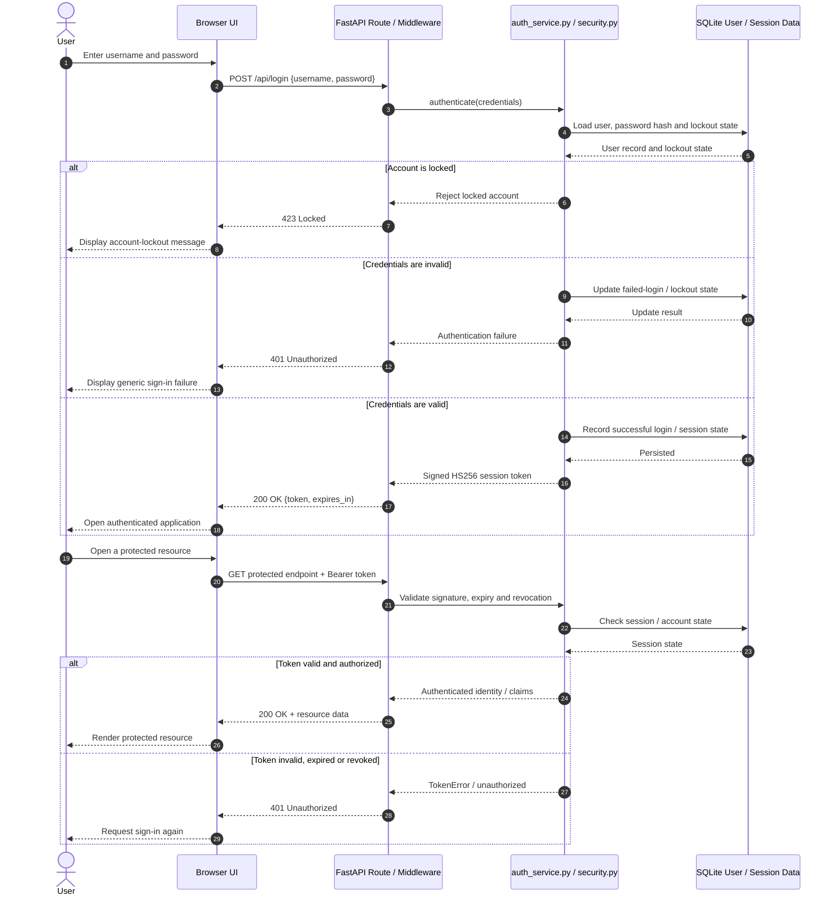
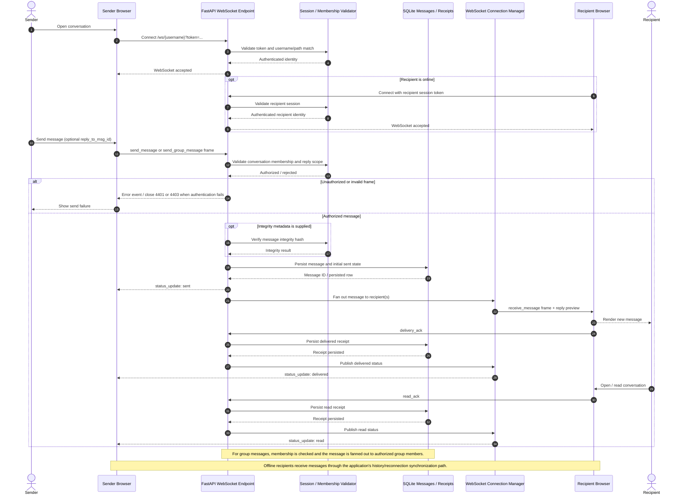

# UML Sequence Diagrams — Chat Application

**Project:** Chat Application (Socket Programming)  
**Document ID:** UML-CHAT-SEQ-001  
**Version:** 1.0  
**Date:** 16 November 2026  
**Implementation baseline:** Current `main` branch; browser FastAPI/REST/WebSocket implementation.

These diagrams describe the current browser implementation. The terminal TCP client/server is a separate companion interface and is not represented in these two browser interaction flows.

## 1. Account login and protected-session validation

**Main controls represented:** password verification, account lockout, signed session-token issuance, token signature/expiry/revocation validation, and protected-route authorization. The login response and protected-resource status codes reflect the current SAD/API description.

## 2. Authenticated private/group message delivery, reply and receipts

**Main controls represented:** authenticated WebSocket connection, token/path identity matching, private/group membership authorization, optional integrity validation, persistence before delivery, reply reference handling, and sent/delivered/read receipt updates.

## Implementation notes

- WebSocket authentication failures use close codes `4401` (invalid authentication) and `4403` (identity mismatch), as documented in the SAD.
- HTTP APIs remain responsible for account/resource management; WebSockets carry live messaging events.
- The diagram intentionally does not claim exactly-once network delivery. Message IDs, persistence and deduplication/receipt behavior are implementation mechanisms; transient network failure can still require reconnection and synchronization.
- These are design-level sequence diagrams aligned to the repository's documented interfaces, not packet captures or a guarantee that external providers are available.
